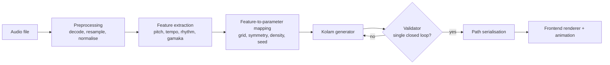

# Swara to Sikku

**Music-driven procedural generation of Brahma Mudi (single-line Sikku Kolam) from Carnatic audio.**

---

## Contents

1. [Abstract](#1-abstract)
2. [Problem Statement](#2-problem-statement)
3. [Domain Background](#3-domain-background)
4. [System Architecture](#4-system-architecture)
5. [Audio Analysis Module](#5-audio-analysis-module)
6. [Feature-to-Parameter Mapping](#6-feature-to-parameter-mapping)
7. [Kolam Generation Module](#7-kolam-generation-module)
8. [Rendering and Animation](#8-rendering-and-animation)
9. [API Specification](#9-api-specification)
10. [Repository Structure](#10-repository-structure)
11. [Setup](#11-setup)
12. [Evaluation Plan](#12-evaluation-plan)
13. [Limitations and Risks](#13-limitations-and-risks)
14. [Roadmap](#14-roadmap)
15. [Development Workflow](#15-development-workflow)
16. [References](#16-references)

---

## 1. Abstract

Carnatic music and Sikku Kolam are separate South Indian art forms that share a common structural property: both are organised as repetitive, cyclic and symmetric patterns. This project builds a system that exploits that shared structure. Given a Carnatic audio recording, the system extracts melodic and rhythmic features, maps them deterministically onto the parameters of a kolam generator, and produces a **Brahma Mudi**, a kolam drawn as one continuous closed line around a grid of dots. The output is rendered digitally and can be replayed as a stroke-by-stroke drawing animation.

## 2. Problem Statement

Two problems are addressed together.

**Cultural.** Brahma Mudi is traditionally drawn with rice flour at home entrances. The practice is declining, and few digital tools exist that represent it as more than a static image.

**Computational.** Generating a Brahma Mudi is a constrained generation problem: the output must be a single closed curve that encloses the dot grid correctly, which rules out naive random drawing. The generation must additionally be *controllable* by an external signal (music) while preserving that guarantee.

**Goal.** Build a pipeline that, for any valid Carnatic audio input, returns a valid Brahma Mudi whose visual properties (size, symmetry, intricacy) are systematically determined by measurable properties of the music.

**Non-goals.** This project does not attempt raga identification, transcription to notation, or any claim that the generated kolam is a canonical "translation" of the music. The mapping is a designed, documented correspondence.

## 3. Domain Background

### 3.1 Carnatic music
Carnatic music is organised around **raga** (melodic framework), **tala** (rhythmic cycle) and **gamaka** (ornamental pitch movements around and between notes). Phrases ascend (*arohanam*) and descend (*avarohanam*), recur, and are structured within cyclic beat patterns. Pitch is interpreted relative to the performer's tonic (*Sa*), not in absolute terms.

### 3.2 Sikku Kolam and Brahma Mudi
Sikku (Chikku) Kolam is a family of kolams in which a line is looped around a lattice of dots (*pullis*). **Brahma Mudi** is the variant in which the whole design is a **single continuous closed curve**. A valid Brahma Mudi satisfies:

1. The drawing is one closed curve (one connected component, no free ends).
2. The curve never lifts and is traced in a single pass.
3. Every pulli in the grid is encircled by the curve.

Kolam geometry has been studied formally, including a mirror-reflection model in which a line travels through a lattice and reflects at mirror elements; the number of closed curves in a configuration can then be computed exactly. This project uses that formulation for generation and validation.

## 4. System Architecture



The system has three independent components with defined interfaces:

| Component | Input | Output |
|---|---|---|
| Audio analysis | Audio file | `FeatureVector` (JSON-serialisable) |
| Mapping | `FeatureVector` | `KolamParams` |
| Kolam generator | `KolamParams` | Ordered path + metadata |

Because the interfaces are explicit, each component can be developed and tested in isolation, and the generator can be exercised without any audio at all.

## 5. Audio Analysis Module

### 5.1 Preprocessing
Audio is decoded, converted to mono, resampled to a fixed rate and trimmed of leading and trailing silence. Analysis is performed on a bounded excerpt to keep latency predictable.

### 5.2 Extracted features

| Feature | Method | Notes |
|---|---|---|
| Fundamental frequency (f0) contour | Pretrained pitch model (CREPE) with pYIN as fallback | Voiced-frame mask applied |
| Tonic estimate | Histogram of f0 in cents, taking the dominant stable peak as *Sa* | Pitch is then expressed in cents relative to the tonic, making it comparable across singers and recordings |
| Pitch range and distinct-pitch count | Quantised, tonic-relative pitch histogram | Proxy for swara usage |
| Gamaka intensity | Rate of f0 change, local oscillation energy and fraction of frames spent in transition rather than steady notes | Aggregated to a normalised scalar |
| Phrase symmetry | Self-similarity of the pitch contour under time reversal and repetition | Proxy for arohanam/avarohanam mirroring and cyclic structure |
| Tempo | Onset-envelope tempo estimation | Reported with a confidence value |
| Cycle length | Autocorrelation of the onset envelope | Proxy for a tala-like repeating cycle |

All features are normalised to documented ranges and returned as a single `FeatureVector`. Each carries a confidence value so that downstream mapping can degrade gracefully when estimation is unreliable (see [Limitations](#13-limitations-and-risks)).

## 6. Feature-to-Parameter Mapping

The mapping is a pure, deterministic function: identical `FeatureVector` in, identical `KolamParams` out.

| Musical feature | Kolam parameter | Rule |
|---|---|---|
| Pitch range / distinct-pitch count | Grid size `n` (odd, bounded) | Monotonic, quantised to a fixed set of sizes |
| Phrase symmetry score | Symmetry mode: none, mirror, four-fold | Threshold bands |
| Gamaka intensity | Local turn / curl density | Monotonic, bounded |
| Tempo and cycle length | Crossing density and structural repetition period | Bounded linear map |
| Hash of quantised pitch contour | Generator seed | Stable hash, so similar melodic shapes give related outputs |

The mapping table is the project's central design artefact. It is kept in configuration, not hard-coded, so that alternatives can be compared in the evaluation.

## 7. Kolam Generation Module

### 7.1 Representation
The kolam is a lattice of pullis. Mirror elements are placed in the lattice according to the parameters; a line entering the structure reflects at each mirror and its trajectory defines the drawn curve.

### 7.2 Generation procedure
1. Build an initial mirror configuration from `KolamParams`, imposing the requested symmetry on the configuration so symmetry holds by construction.
2. Trace every closed trajectory through the lattice.
3. Count closed curves. If the count is not exactly one, apply a local repair (flip a mirror that merges two distinct curves) and re-trace.
4. Repeat until a single closed curve covering all required segments is obtained, or a bounded iteration limit is reached, in which case the generator reseeds deterministically and tries again.
5. Smooth the polyline into a curve around each pulli for rendering.

### 7.3 Validator
An independent validator checks every output before it leaves the backend: a single connected closed curve, no dangling segments, every pulli encircled, and consistency with the requested symmetry. **A kolam that fails validation is never returned.** The validator is also the main target of the automated test suite.

### 7.4 Complexity
Tracing is linear in the number of lattice edges, so validation and each repair iteration are inexpensive for the grid sizes in scope.

## 8. Rendering and Animation

- The path is returned as an ordered list of lattice coordinates plus smoothed curve data.
- The frontend draws pullis and the curve as SVG.
- The **drawing animation** reveals the curve in traversal order using stroke-dash animation, with speed control and pause/restart, demonstrating the single-stroke property.
- Export: SVG and PNG.

## 9. API Specification

### `POST /generate`

Request: `multipart/form-data` with an `audio` file (`mp3`, `wav`).

Response `200`:
```json
{
  "features": {
    "tempo_bpm": 92.0,
    "cycle_beats": 8,
    "pitch_range_cents": 2400,
    "gamaka_intensity": 0.63,
    "symmetry_score": 0.71,
    "confidence": { "tempo": 0.82, "pitch": 0.91 }
  },
  "params": {
    "grid_size": 9,
    "symmetry": "four_fold",
    "turn_density": 0.6,
    "seed": 184220913
  },
  "kolam": {
    "grid_size": 9,
    "path": [[0, 0], [1, 0], [1, 1]],
    "closed": true,
    "validated": true
  }
}
```

Errors: `400` unsupported or undecodable file, `413` file too large, `422` audio too short or no voiced content detected.

### `POST /generate/params`
Accepts `KolamParams` directly and returns a kolam, allowing the generator to be used and tested without audio.

## 10. Repository Structure

```
.
├── backend/
│   ├── audio/          # preprocessing and feature extraction
│   ├── mapping/        # FeatureVector -> KolamParams (config-driven)
│   ├── kolam/          # generator, repair, validator
│   ├── api/            # FastAPI routes and schemas
│   ├── tests/
│   └── requirements.txt
├── frontend/
│   ├── src/            # upload UI, renderer, animation
│   └── package.json
├── docs/               # design notes, mapping rationale, evaluation results
└── README.md
```

## 11. Setup

Requirements: Python 3.10+, Node.js 18+.

```bash
# Backend
cd backend
python -m venv venv && source venv/bin/activate
pip install -r requirements.txt
uvicorn api.main:app --reload

# Frontend
cd frontend
npm install
npm run dev
```

Run tests:
```bash
cd backend && pytest
```

## 12. Evaluation Plan

| Aspect | Method | Target |
|---|---|---|
| Validity | Generate across a large range of parameters and seeds; run the validator | 100% of returned kolams valid |
| Determinism | Re-run identical inputs | Identical output |
| Sensitivity | Vary one musical feature at a time on controlled audio | Corresponding kolam parameter changes monotonically |
| Discrimination | Compare outputs across recordings in different ragas/talas | Distinguishable outputs; similar recordings give similar outputs |
| Robustness | Noisy, short, instrumental and non-Carnatic inputs | Graceful handling with correct error responses |
| Perceptual | Small user study: do listeners match music to its kolam above chance? | Reported with sample size and method |
| Performance | End-to-end latency on a fixed-length excerpt | Reported per stage |

Results will be recorded in `docs/`.

## 13. Limitations and Risks

- **Tempo and tala estimation:** standard beat-tracking is designed mostly for Western music and can be unreliable on Carnatic rhythm, particularly for free-time (*alapana*) sections where there is no steady beat. The system reports confidence and falls back to defaults when confidence is low.
- **Pitch estimation:** polyphonic recordings (voice with violin and mridangam) can degrade f0 tracking. Voiced-frame masking and a pYIN fallback mitigate this but do not remove it.
- **Mapping validity:** the mapping encodes design choices, not an objective equivalence between music and kolam. It is documented and configurable, and its effectiveness is judged by the evaluation above.
- **Generation guarantees:** the repair loop is bounded. Reseeding guarantees termination, but extreme parameter combinations may yield simpler kolams than requested.

## 14. Roadmap

| Phase | Deliverable |
|---|---|
| 1 | Kolam generator and validator, tested independently of audio |
| 2 | Audio feature extraction with tonic normalisation |
| 3 | Mapping layer and `/generate` API |
| 4 | Frontend: upload, rendering, drawing animation |
| 5 | Evaluation and tuning of the mapping |
| 6 | Documentation, demo and release |

**Possible extensions:** raga identification with raga-specific kolam styles, additional kolam families, live microphone input, user-editable mapping profiles.

## 15. Development Workflow

- `main` is always in a working state.
- Work proceeds on short-lived branches named `feature/<topic>`, `fix/<topic>` or `docs/<topic>`.
- Changes enter `main` through pull requests with at least one review.
- Commits follow a conventional format, for example `feat(kolam): add single-loop validator`.
- The generator and validator require tests before merge.

## 16. References

- Siromoney, G., Siromoney, R., and Krithivasan, K. Research on kolam patterns and array grammars.
- Nagata, S. and Robinson, T. Digital kolam and mirror-model analyses of Sikku Kolam.
- Kim, J. W. et al. *CREPE: A Convolutional Representation for Pitch Estimation.* ICASSP 2018.
- McFee, B. et al. *librosa: Audio and Music Signal Analysis in Python.*
- Mauch, M. and Dixon, S. *pYIN: A Fundamental Frequency Estimator Using Probabilistic Threshold Distributions.* ICASSP 2014.

> Verify and complete citation details before publication.
